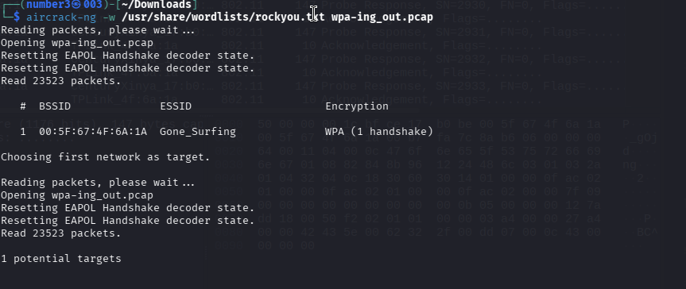
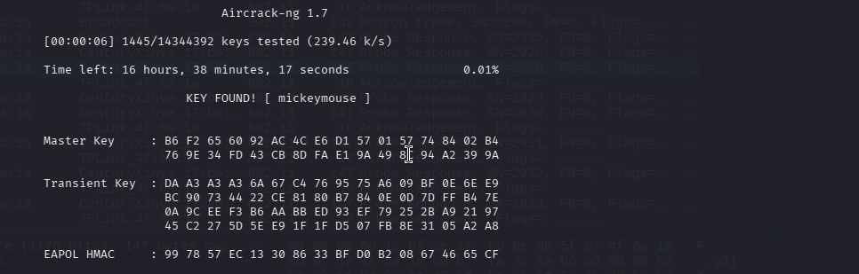

# [WPA-Ing Out] - PicoCTF [2025]

**Category:** Forensics 
**Difficulty:** Easy

--- 

## Description 

I thought that my password was super-secret, but it turns out that passwords passed over the AIR can be CRACKED, especially if I used the same wireless network password as one in the rockyou.txt credential dump. Use this 'pcap file' and the rockyou wordlist. The flag should be entered in the academy{XXXXXX}. format.

--- 

## Analysis

The attachment is a `.cap` file — a wireless packet capture that contains a **WPA handshake**. During a WPA/WPA2 connection, the client and access point exchange a 4-way handshake to authenticate. This handshake does **not** transmit the password directly, but it contains enough cryptographic material to verify a password guess offline.

The attack strategy is a **dictionary attack**: we supply a wordlist of candidate passwords and let the tool hash each one using the captured handshake parameters (SSID, BSSID, nonce values). If a candidate produces a hash that matches what is recorded in the handshake, that candidate is the real password.

The challenge description explicitly hints that the password exists in **rockyou.txt** — one of the most well-known credential dumps, pre-installed in Kali Linux at:
```
/usr/share/wordlists/rockyou.txt
```

We use **`aircrack-ng`**, a standard Wi-Fi security auditing suite, to perform this attack. It parses the `.cap` file, extracts the WPA handshake automatically, and tests every password in the wordlist against it.

---

## Solutions

A single command is enough to crack the password and print the flag directly:

```bash
aircrack-ng wpa-ing_out.cap -w /usr/share/wordlists/rockyou.txt
```


`aircrack-ng` reads the handshake from the capture file, iterates through every entry in `rockyou.txt`, and outputs the cracked key once a match is found.



---

## Flag!

academy{mickeymouse}

---

## Takeaways

- **WPA/WPA2 4-way handshake** — The authentication exchange between a client and an access point. It does not expose the password in plaintext, but capturing it allows offline brute-force or dictionary attacks.

- **Dictionary attack** — Instead of trying every possible character combination (brute-force), a dictionary attack tests a pre-built list of likely passwords. `rockyou.txt` contains over 14 million real-world leaked passwords, making it the standard starting wordlist in CTF and penetration testing.

- **`aircrack-ng`** — A Wi-Fi security auditing tool that can capture handshakes and crack WEP/WPA/WPA2 keys. The `-w` flag specifies the wordlist to use.
  ```bash
  aircrack-ng <capture.cap> -w <wordlist>
  ```

- **rockyou.txt** — A credential dump from the 2009 RockYou data breach containing ~14.3 million plaintext passwords. Pre-installed in Kali Linux at `/usr/share/wordlists/rockyou.txt`. It is the go-to first wordlist whenever a challenge hints the password is "common".


