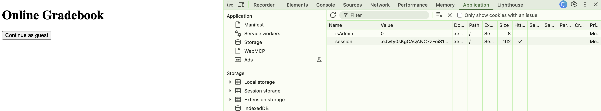
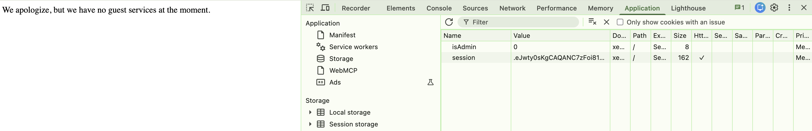
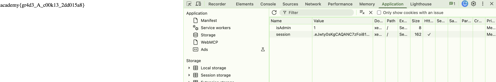

# [Power Cookies] – PicoCTF [2022]

**Category:** Web Exploitation  
**Difficulty:** Medium 

---

## Description

Can you get the flag? Go to this website
 and see what you can discover.

---

## Analysis

After accessing the challenge website, I started by inspecting the page and checking how the website handled user authentication.

Since this was a web exploitation challenge, I decided to examine the browser's **Developer Tools** (F12), particularly the **Application** tab, to inspect the cookies stored by the website.



Inside the Cookies section, I discovered a cookie named `isAdmin`, which was currently set to `0` when I click **Continue as guest**.



This immediately caught my attention because the cookie name suggested that it controlled whether the current user had administrator privileges.

A common implementation of this type of authorization mechanism is to use boolean-like values:
- `0`: False (regular user).
- `1`: True (administrator).

Therefore, I suspected that changing this cookie value could grant me administrative access.

---

## Solution

To exploit this, I simply modified the `isAdmin` cookie from `0` to `1`.

After refreshing the website, the application recognized my session as an administrator, allowing me to access the admin page and retrieve the flag.



---

## Flag

```
academy{gr4d3_A_c00k13_2dd015a8}
```

---

## Takeaways

- **Cookie Manipulation:** Learned how cookies can store information about a user's session and privileges.
- **Broken Access Control:** Client-side authorization checks can be bypassed if the server blindly trusts user-controlled cookie values.
- **Developer Tools:** Practiced inspecting and modifying cookies directly through the browser's Developer Tools.

**Security Insight:** Authorization decisions should always be validated on the server side. Sensitive privileges such as administrator access must never rely solely on values that users can modify themselves.